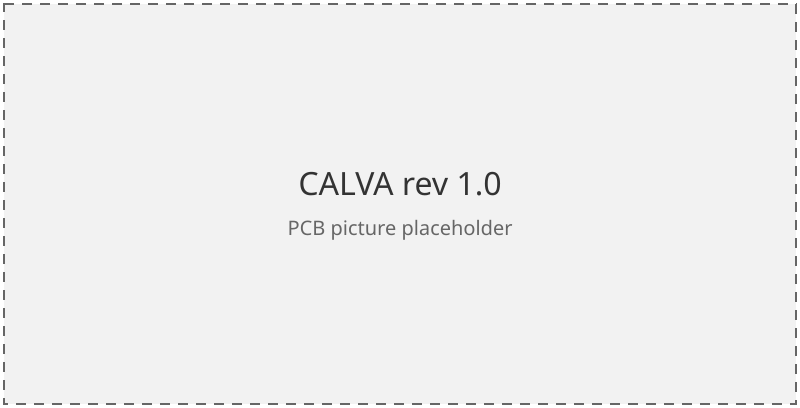
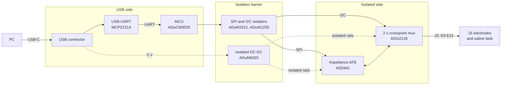

# EIT Skull Tank

A 16-electrode electrical impedance tomography (EIT) system and a 2D saline tank phantom. EIT injects a small AC current through pairs of electrodes, measures the resulting voltages, and reconstructs a conductivity image. CALVA is the project's PCB.

## Research question

How does a skull-analog ring change the minimum detectable inclusion size and the localization error?

Secondary: does a model trained on pyEIT simulation frames work on real tank frames?

## System

## Repository

| Path | Contents |
| --- | --- |
| [`hardware/eit-skull-tank/`](hardware/eit-skull-tank/) | KiCad 10 project and [schematic PDF](hardware/eit-skull-tank/eit-skull-tank.pdf) |
| [`firmware/no-OS`](firmware/no-OS) | Submodule: fork of Analog Devices' no-OS, branch `calva`, no edits yet |
| [`sim/rig.py`](sim/rig.py) | pyEIT mesh of the tank with the skull-analog ring |
| [`environment.yml`](environment.yml) | Python environment |

## Documentation

- [Hardware](docs/hardware.md): reference designs, sheets, stackup, isolation, pin map, fabrication
- [Firmware](docs/firmware.md): build, flashing, Python setup, known issues
- [Experiment](docs/experiment.md): plan, detection threshold, open questions

## Roadmap

No measurements exist yet.

1. PCB rev 1.0 in fabrication
2. SWD probe
3. Assembly and bring-up
4. Perfboard: resistor tests, Y-line mismatch, electrode map
5. Stamps: effective conductivity per hole size and density
6. Simulation: choose the ring, check the expected effect is measurable
7. Tank: build it, measure noise and drift with no inclusion
8. Main dataset: with and without ring, several inclusion sizes and positions
9. pyEIT comparison under the same conditions
10. U-Net: train on simulation, test on real frames, compare against GREIT

## Credits

The CALVA schematic and PCB layout were drawn independently in KiCad. Parts of the circuit follow Analog Devices' public [CN0565](https://www.analog.com/en/resources/reference-designs/circuits-from-the-lab/CN0565.html) and [EVAL-ADICUP3029](https://www.analog.com/en/resources/evaluation-hardware-and-software/evaluation-boards-kits/eval-adicup3029.html) design documents, consulted as references. This project contains no Analog Devices design files and is not affiliated with or endorsed by Analog Devices. Everything here is subject to Analog Devices' terms where they apply.

Firmware is based on Analog Devices' [no-OS](https://github.com/analogdevicesinc/no-OS). Simulation uses [pyEIT](https://github.com/eitcom/pyEIT).

## Licences

All rights reserved for my own work. The no-OS fork keeps its own licensing. See [LICENSE.md](LICENSE.md).
