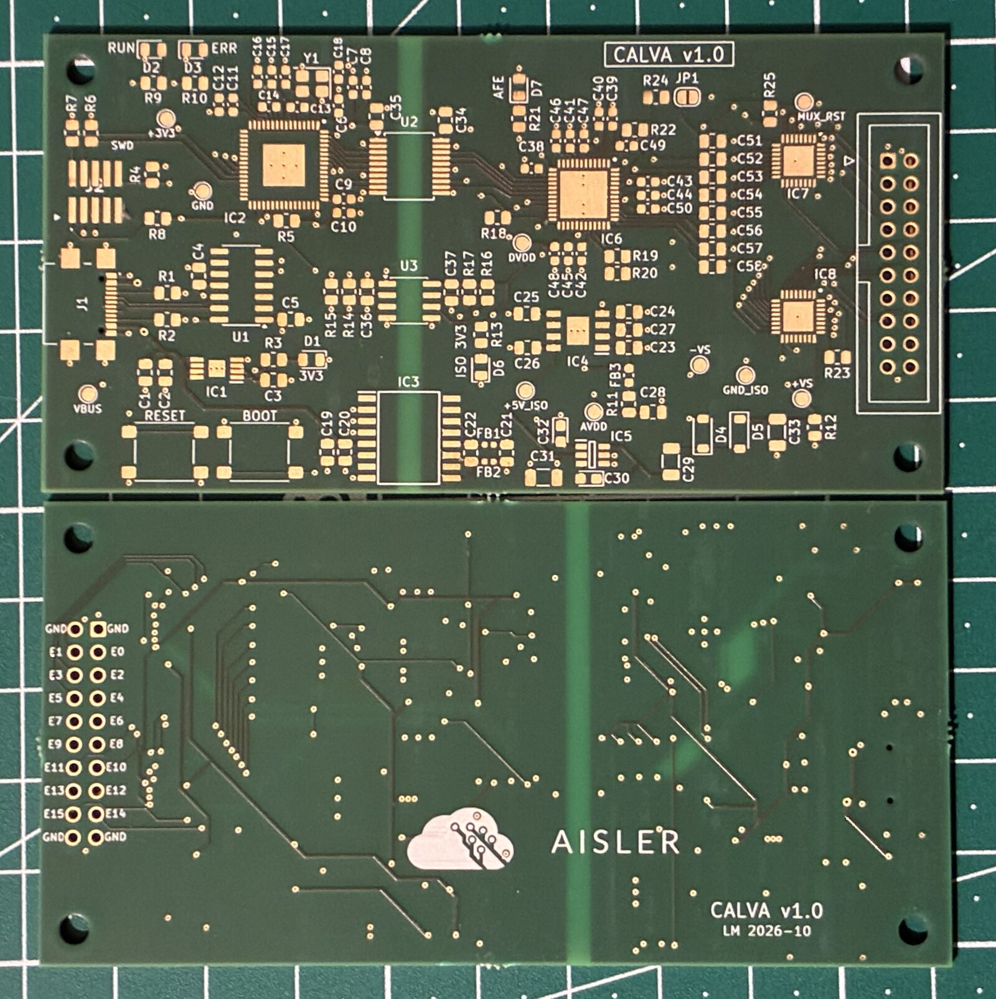

# HARDWARE

## CALVA

*Bare PCB*

- 16-electrode EIT board, rev 1.0, 4-layer, 100 x 51 mm.
- Electrode side isolated from the USB side, following CN0565.

## Based on

- [CN0565](https://www.analog.com/en/resources/reference-designs/circuits-from-the-lab/CN0565.html): AFE, mux, isolation, isolated power.
- [EVAL-ADICUP3029](https://www.analog.com/en/resources/evaluation-hardware-and-software/evaluation-boards-kits/eval-adicup3029.html): MCU, clocks, SWD, LEDs.

## Files

- [eit-skull-tank/](eit-skull-tank/): KiCad 10 project.
- [eit-skull-tank.pdf](eit-skull-tank.pdf): schematic.
- Sheets: [usb_power](eit-skull-tank/usb_power.kicad_sch), [mcu](eit-skull-tank/mcu.kicad_sch), [iso_power](eit-skull-tank/iso_power.kicad_sch), [iso_comm](eit-skull-tank/iso_comm.kicad_sch), [afe](eit-skull-tank/afe.kicad_sch), [mux](eit-skull-tank/mux.kicad_sch).

## Fabrication

- AISLER, 4-layer, 1.6 mm, ENIG, exported with the AISLER KiCad plugin.
- Stencil and hot plate reflow.

## Tank
### TODO